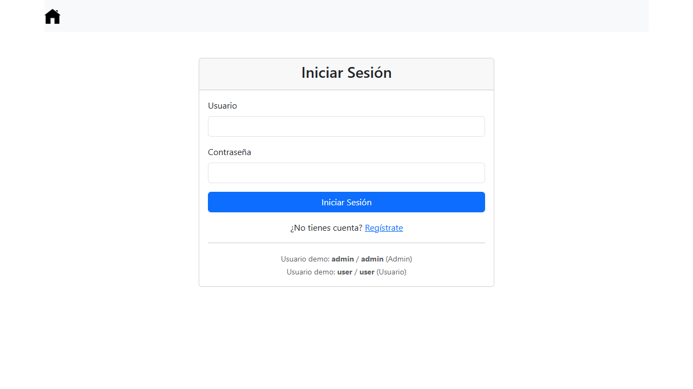
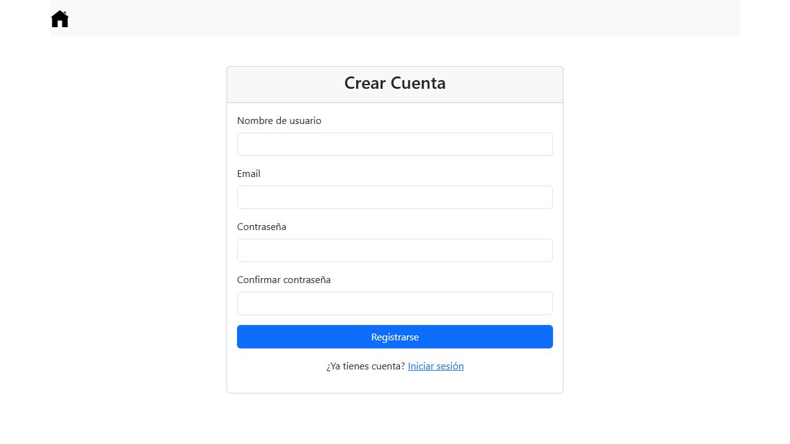
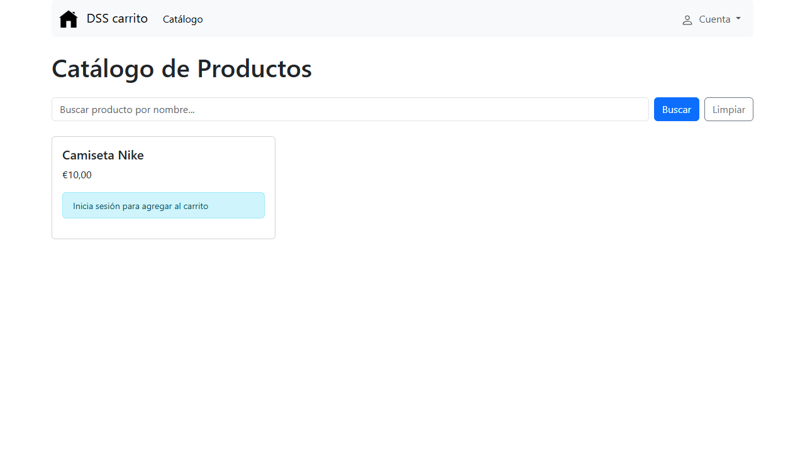
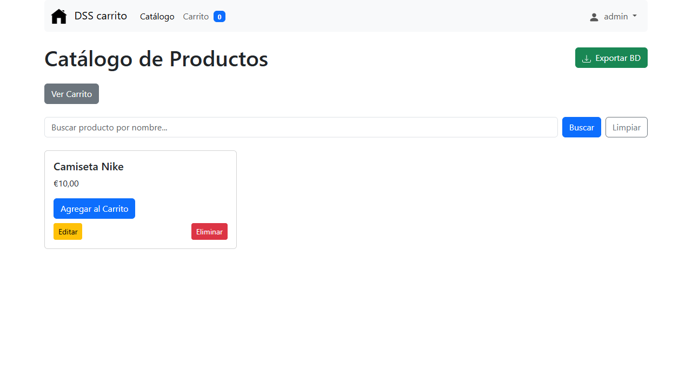
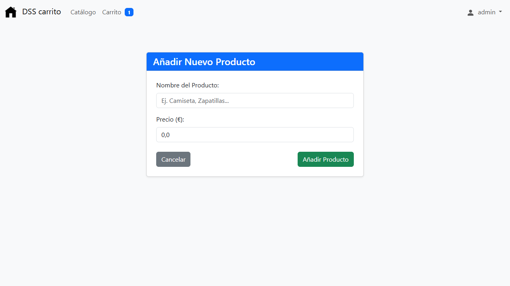
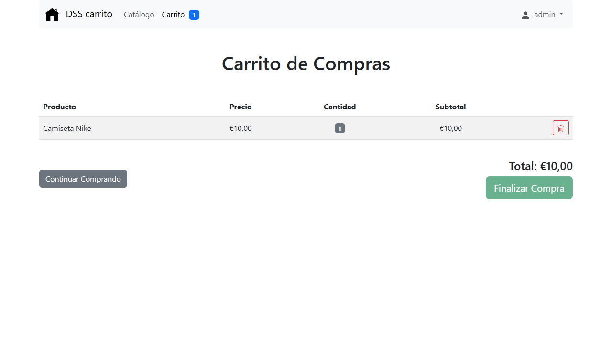

# Carrito App - Spring Boot + PostgreSQL

Aplicacion web de carrito de compras desarrollada con Spring Boot 4.1, Thymeleaf, Spring Security y PostgreSQL.

---

## Despliegue Rapido (Recomendado para el profesor)

### Opcion 1: Docker Compose (Todo en uno) - RECOMENDADO

```bash
# Linux/Mac
./deploy.sh

# Windows (PowerShell)
.\deploy.ps1
```

Esto levanta PostgreSQL y la aplicacion en contenedores. Acceso: http://localhost:8080

---

### Opcion 2: Solo Base de Datos (Desarrollo local)

```bash
# Linux/Mac
./start-db.sh

# Windows (PowerShell)
.\start-db.ps1
```

Luego ejecuta la app localmente:
```bash
./mvnw spring-boot:run
```

> **Nota importante para Windows**: Existe una limitacion conocida en Docker Desktop para Windows con el reenvio de puertos (localhost:5432 -> contenedor). La autenticacion trust en pg_hba.conf no coincide correctamente con las conexiones que pasan por el proxy de Docker Desktop.
>
> **Alternativas para desarrollo local en Windows:**
> 1. Usar Docker Compose completo (Opcion 1) - Funciona perfectamente
> 2. Instalar PostgreSQL nativamente en Windows - Descargar de postgresql.org
> 3. Usar PostgreSQL en la nube (Neon, Supabase, Railway - gratuitos)
> 4. WSL2 + Docker - Mejor compatibilidad de red

---

## Requisitos Previos

- Docker Desktop instalado y corriendo
- Java 17+ (solo para desarrollo local sin Docker)
- Maven (incluido como wrapper mvnw)

---

## Credenciales por Defecto

| Servicio | Usuario | Contraseña |
|----------|---------|------------|
| App (Spring Security) | admin | admin |
| PostgreSQL | postgres | postgres |
| Base de datos | carrito_db | - |

---

## Servicios Docker

| Contenedor | Puerto | Descripcion |
|------------|--------|-------------|
| carrito-postgres | 5432 | Base de datos PostgreSQL 16 |
| carrito-app | 8080 | Aplicacion Spring Boot |

---

## Capturas de Pantalla

### Pantalla de Inicio de Sesion


### Pantalla de Registro


### Catalogo de Productos (sin autenticar)


### Catalogo de Productos (autenticado como admin)


### Formulario de Nuevo Producto (solo admin)


### Carrito de Compras


---

## Guia de Uso

### 1. Primer Acceso
1. Ejecuta `.\deploy.ps1` (Windows) o `./deploy.sh` (Linux/Mac)
2. Espera a que aparezca el mensaje "Aplicacion desplegada correctamente"
3. Abre el navegador en http://localhost:8080
4. Seras redirigido automaticamente a la pagina de login

### 2. Iniciar Sesion
- Usuario administrador: **admin** / **admin**
- Usuario normal: **user** / **user**
- Tambien puedes crear una cuenta nueva desde el enlace "Registrate"

### 3. Navegar por el Catalogo
- Tras iniciar sesion, accedes al catalogo de productos
- Usa la barra de busqueda para filtrar productos por nombre
- Haz clic en "Agregar al Carrito" para anadir productos

### 4. Gestionar el Carrito
- Accede al carrito desde el icono en la barra de navegacion (muestra contador)
- Veras una tabla con: producto, precio, cantidad, subtotal
- Usa el boton de papelera para eliminar items
- El total se calcula automaticamente
- El boton "Finalizar Compra" esta deshabilitado (funcionalidad pendiente)

### 5. Administracion de Productos (solo rol ADMIN)
- En el menu desplegable de usuario, selecciona "Administrar Productos"
- Veras botones "Editar" y "Eliminar" en cada tarjeta de producto
- Accede a "Añadir Producto" para crear nuevos productos
- Completa el formulario con nombre y precio
- Disponible opcion "Exportar BD" para descargar datos

### 6. Cerrar Sesion
- En el menu desplegable de usuario, haz clic en "Cerrar Sesion"

---

## Comandos Utiles

```bash
# Ver logs de la app
docker-compose logs -f app

# Ver logs de PostgreSQL
docker-compose logs -f postgres

# Parar todo
docker-compose down

# Parar y borrar volumenes (reset total BD)
docker-compose down -v

# Reconstruir app tras cambios de codigo
docker-compose build app && docker-compose up -d app
```

---

## Estructura del Proyecto

```
src/
├── main/
│   ├── java/com/practicas/__carrito/
│   │   ├── controller/     # Controladores Web (Thymeleaf)
│   │   ├── model/          # Entidades JPA (Product, User, CartItem)
│   │   ├── repository/     # Spring Data JPA Repositories
│   │   ├── service/        # Logica de negocio
│   │   └── config/         # Seguridad
│   └── resources/
│       ├── templates/      # Vistas Thymeleaf
│       └── application.properties
├── test/
├── pom.xml
├── Dockerfile
├── docker-compose.yml
├── deploy.sh / deploy.ps1
└── start-db.sh / start-db.ps1
```

---

## Endpoints Principales

| Metodo | Ruta | Descripcion |
|--------|------|-------------|
| GET | / | Pagina principal (redirige a login) |
| GET | /login | Formulario de login |
| GET | /register | Formulario de registro |
| GET | /products | Listado de productos (requiere login) |
| GET | /products/add | Formulario nuevo producto (ADMIN) |
| POST | /products | Guardar producto (ADMIN) |
| GET | /products/edit/{id} | Editar producto (ADMIN) |
| GET | /products/delete/{id} | Eliminar producto (ADMIN) |
| GET | /products/export | Exportar base de datos (ADMIN) |
| GET | /cart | Ver carrito (requiere login) |
| POST | /cart/add/{id} | Añadir al carrito |
| POST | /cart/remove/{id} | Quitar del carrito |
| POST | /logout | Cerrar sesion |

---

## Build Manual (sin Docker)

```bash
# Compilar
./mvnw clean package

# Ejecutar JAR
java -jar target/1_carrito-0.0.1-SNAPSHOT.jar
```

---

## Variables de Entorno (Produccion)

| Variable | Descripcion | Default |
|----------|-------------|---------|
| SPRING_DATASOURCE_URL | URL JDBC PostgreSQL | jdbc:postgresql://localhost:5432/carrito_db |
| SPRING_DATASOURCE_USERNAME | Usuario BD | postgres |
| SPRING_DATASOURCE_PASSWORD | Contraseña BD | postgres |
| SPRING_JPA_HIBERNATE_DDL_AUTO | Estrategia DDL | update |

---

## Notas para el Profesor

1. Todo esta containerizado: Solo necesita Docker Desktop instalado
2. Un solo comando: ./deploy.sh o .\deploy.ps1 levanta todo
3. Datos persistentes: PostgreSQL usa volume postgres_data (sobrevive a reinicios)
4. Healthchecks: La app espera a que PostgreSQL este listo antes de arrancar
5. Multiplataforma: Scripts para Windows (.ps1) y Linux/Mac (.sh)

---

## Troubleshooting

**Puerto 8080 ocupado:**
```bash
# Cambiar puerto en docker-compose.yml: "8081:8080"
```

**Error de conexion a BD:**
```bash
# Verificar que PostgreSQL esta healthy
docker-compose ps
docker-compose logs postgres
```

**Reinicio limpio total:**
```bash
docker-compose down -v && ./deploy.sh
```

**Desarrollo local en Windows (./mvnw spring-boot:run):**
```bash
# Si falla la conexion a PostgreSQL en localhost:5432:
# 1. Usar Docker Compose completo (recomendado): .\deploy.ps1
# 2. O instalar PostgreSQL nativo en Windows
# 3. O configurar BD en la nube (Neon, Supabase - gratis)
```

---

## Funcionalidades Principales

### Autenticacion y Autorizacion
- Spring Security con formulario de login personalizado
- Registro de nuevos usuarios con validacion
- Roles: USER (usuario estandar) y ADMIN (administrador)
- Proteccion CSRF en todos los formularios
- Sesiones persistentes

### Gestion de Productos
- Listado con paginacion implícita (tarjetas Bootstrap)
- Busqueda por nombre en tiempo real
- CRUD completo para administradores
- Validacion de datos en servidor y cliente
- Exportacion de base de datos a SQL

### Carrito de Compras
- Anadir productos desde el catalogo
- Visualizar items con precio, cantidad y subtotal
- Eliminar items individuales
- Calculo automatico del total
- Contador de items en la barra de navegacion
- Persistencia en base de datos por usuario

### Interfaz de Usuario
- Bootstrap 5.3 para diseno responsive
- Navegacion consistente en todas las paginas
- Menu de usuario con dropdown contextual
- Mensajes de error y exito
- Iconos SVG integrados

### Base de Datos
- PostgreSQL 16 en contenedor Docker
- Esquema generado automaticamente por Hibernate (ddl-auto: update)
- Datos de prueba insertados al arranque
- Volumen persistente para supervivencia de datos